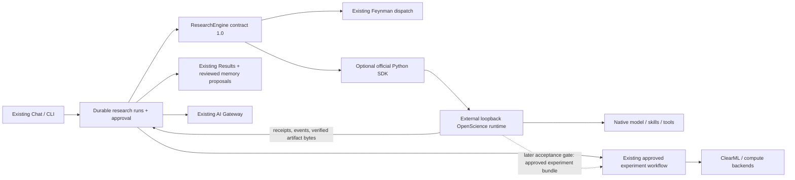

# ADR: OpenScience as an externally managed research engine

Status: incremental implementation; production qualification requires live scientific acceptance.

## Evidence audited before editing

PhD Lab's Engineering Principles require a modular monolith, typed/versioned boundaries, replaceable engines and real integration tests. Current `agent/launch.py` creates durable `agent/runs.py` workflows; `providers/research.py` owns Feynman dispatch. The LLM gateway is a different boundary. Runs already supply approvals, cancellation, step retry budgets, resource slots, chat mirroring and pin proposals. ClearML and remote-compute records exist separately; none makes an arbitrary external engine's completed chat a verified experiment.

OpenScience source was inspected at **d720862157d146d52b6faae1e5aff9d3973ed918**, package source version **2.0.152**. Authoritative paths:

* `frontend/docs/src/content/openscience/api.mdx`, `server-hosting.mdx`
* `tooling/sdk/python/README.md`, `openscience/client.py`, `tests/server_conformance.py`
* `backend/cli/src/server/routes/runtime.ts`, `runtime/runs.ts`, `runtime/events.ts`, `runtime/decisions.ts`
* `backend/cli/src/artifact/store.ts`, `server/routes/file.ts`, `permission/next.ts`
* `ARCHITECTURE.md`, `LICENSE`, `NOTICE`

The repository supplies HTTP/SSE runtime protocol 1.0 and an official standard-library Python client (`openscience-runtime` 0.1.0, a source preview, not a published PyPI release). Commands include session creation, prompt admission, durable receipts, snapshots, cancellation and decisions. This is preferable to scraping `openscience run` terminal output. The SDK does not expose all artifact operations; their public HTTP endpoints can be used without private client methods.

Native skills are discovered and loaded by OpenScience. No bundled skills will be copied into PhD Lab's plugin registry. A single `/science` delegation entrypoint is an orchestration command, not a mirror of the native library. OpenScience owns its model/provider credentials; PhD Lab does not forward application API keys.

## Decision

Add a small `research_engines` boundary: typed tasks, events, results, normalized failures and lazy adapter registration. Adapt the existing Feynman implementation rather than replacing it. The core asks the registry to execute a research task; OpenScience remains an optional adapter using the official Python client against an **externally managed loopback server**. Do not launch a service per prompt, embed Bun in Python, replace the frontend or introduce a second experiment scheduler.

PhD Lab owns workflow/session correlation, frozen context manifests, receipts/cursors, approvals, collected artifacts and scientific review state. OpenScience owns its native session, tools, skill loading, internal planning and inference. Native workers are disabled for this first increment. A protocol capability probe establishes transport compatibility, not scientific or model competence.

The engine picker is separate from the LLM picker. Support Auto, Feynman Only, OpenScience Only and a bounded Collaborative mode. Auto considers declared task capabilities, explicit qualification and availability. Collaborative means an explicit bounded workflow (one primary step and one cross-review), not an autonomous engine-to-engine loop. Existing workflows are the default when the new adapter is disabled.

## Critical failure semantics

Persist the external request identity and exact input before submitting. An uncertain acceptance never triggers another request ID or a fallback transport/provider. Reattach to an existing run receipt. Recover cursor gaps through snapshots and authoritative messages, never by prompting again. A disconnect does not cancel work. Cancellation targets the recorded run; an unconfirmed cancellation remains an explicit unresolved state. Server death yields interrupted work, not exactly-once external effects.

Only decisions in a fresh runtime snapshot are actionable. The adapter exposes `once` and `reject`, never installation-wide grants. Questions require an explicit answer. Pending continuations are process-local; historical permission events cannot be replayed as approvals after a restart.

Use a dedicated PhD Lab staging workspace per step, a restrictive project permission policy, no implicit repository/dataset upload, explicit tool execution opt-in, bounded time/response/artifact limits and PhD Lab resource slots. Provider permission rules are not an OS sandbox. Externally launched tools and remote jobs are not automatically controlled by PhD Lab's local GPU guard; remote compute dispatch remains disabled in this increment. Untrusted code needs an actual execution boundary configured outside the adapter.

## Security and licensing

The server's deployment token protects one trusted runtime; `directory` is a selector, not tenant authorization. Reject non-loopback endpoints in this increment, reject redirects, require a deployment token and prevent cross-project job access. Keep credentials out of journals, events and artifacts. Audit actual effective permissions before inference; do not silently change the user's global OpenScience settings.

Upstream trace sharing can include scientific content for signed-in accounts. The integration must require an explicit operator acknowledgement of the runtime's privacy/configuration, and its setup guide must explain upstream trace controls. A local endpoint alone does not imply data never leaves the machine.

The main upstream license is Apache-2.0. `NOTICE` and per-skill attribution include other licenses (including MIT, CC-BY and document-skill-specific terms). Referencing an external runtime avoids redistributing its skill tree, but does not waive its dependencies' or connected services' terms. This is a source/license inventory, not a legal compliance opinion.

## Incremental roadmap and acceptance gates

1. Typed boundary, lazy registry, capability/health negotiation and architecture tests. Preserve legacy Feynman tests. No default dependency or cloud call.
2. Opt-in official SDK adapter: durable admission, streaming, reconnect/reconciliation, explicit cancellation, live decisions and bounded, hash-verified artifact collection. Test against socket fixtures and the real SDK. A fixture is not an OpenScience server.
3. Integrate with existing runs/chat/settings, approval and resource guards. Verify manual/auto/collaborative planning, no engine/LLM conflation, no quota fallback to weak local inference and no native-skill duplication. Reuse Results/pin proposals and record provenance; do not auto-promote conclusions.
4. Live isolated runtime protocol conformance: check capabilities, sessions, snapshots, cursor failures and cancellation against the installed server without model calls. If its protocol is older or startup fails, report it and keep disabled.
5. Scientific acceptance, explicitly configured: five supplied papers → two cited gaps → approved hypothesis → baseline with a real ClearML task → verified metrics/artifacts → evidence-based critique. Inject quota failure, stream gap, process restart and artifact corruption. Resume only the unfinished step; no duplicate training. This gate cannot be claimed from mock outputs.
6. Later: runtime-owned workers with verified admission limits, approved compute handoff, read-only native capability metadata and richer collaboration. Do not rebuild upstream tools or introduce a generic plugin framework ahead of demonstrated need.

## Acceptance matrix

| Case | Required result |
|---|---|
| Missing SDK / disabled engine / protocol mismatch | Explicit unavailable descriptor; existing chat/Feynman continue |
| Typed task/contract/version mismatch | Rejected before submission |
| Duplicate local execution / ambiguous prompt response | Same durable request identity; no new prompt or fallback |
| SSE duplicate / expired cursor / EOF | Deduplicate or reconcile snapshot/receipt; EOF is not completion |
| Native permission or question | Needs user action; fresh snapshot; only once/reject or explicit answer |
| Timeout/cancel | Explicit cancel request, retained receipt and partial output; unresolved settlement is visible |
| Artifact path traversal / symlink / oversized or mismatched blob | Refused; never read arbitrary local paths from engine output |
| Completed agent with detached compute | No fabricated completed experiment or ClearML task |
| Context or model change | New task/version where appropriate; no reuse of stale compiled context |
| Research outputs | Stable run/session/artifact IDs, checksums and provenance; memory/pins remain proposals |
| Cross-engine review | At most configured stages; finished primary result survives review failure |

Pinned source: https://github.com/synthetic-sciences/openscience/tree/d720862157d146d52b6faae1e5aff9d3973ed918

## Implementation and verification outcome

The first increment implements the typed boundary, existing Feynman bridge, optional SDK adapter, durable journals, event observation, decision/recovery endpoints and integration with existing run cards/settings/Results proposals. Actual installed runtime 2.0.152 passed isolated authentication, permission/configuration, session, snapshot, replay, cursor-conflict and artifact-inventory probes without model inference. The official SDK was exercised from the audited source, including its upstream socket tests; it is not silently installed into the application's base environment.

Regression evidence and remaining gates are recorded in `artifacts/openscience-audit/acceptance.json` and `docs/openscience-integration.md`. Scientific acceptance, live active-tool cancellation/restart, approved file/dataset transfer and real ClearML task handoff remain pending. This decision does not declare a production-qualified multi-engine scientific workflow.
