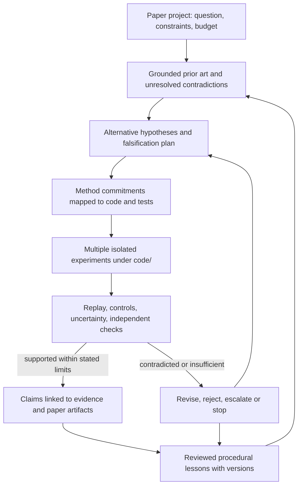

# Research quality review and architecture direction

This is a design and gap assessment, not certification that PhD Research Lab has reached L3. The requested source versions were downloaded with SHA256 receipts; responsibility and architecture figures were inspected. Full references and illustrative benchmark claims are not treated as independently reproduced findings. Source receipts live under output/playwright/research-quality-papers/sources.json.

The owner's governing design is one agent-native scientific research environment. Autonomy levels share infrastructure and differ through authority, action scope, approval and verification. Do not implement another Research Engine or a fixed workflow per domain/level. The environment-level Explore/Attempt/Evaluate/Learn/Propose/Evolve cycle is documented in agent/OPEN_ENDED_CAPABILITY_LEARNING.md; the agent chooses its actual research strategy. The initial implementation work is the reasoning-interference audit and evidence-backed corrections, not framework expansion.

## Reading the two papers critically

**AutoResearch AI.** Its taxonomy separates research assistance, human-verified execution and AI-led coordination. L3 requires credible ordinary progress with human involvement concentrated on supervision/exceptions; L4 is an aspirational upper bound. The paper evaluates novelty, validity, impact, reliability and provenance separately and warns against equating pipeline breadth with scientific autonomy. Its discussion calls for results to revise hypotheses, rather than feed only the manuscript. This is a useful assessment framework; it is not an experimental demonstration that a particular architecture achieves L3. [Sections1,3,4,6; Figures1–2](https://arxiv.org/html/2605.23204v1).

**AI-Researcher.** Resource analysis connects mathematical concepts to code; implementation/advisor feedback and hierarchical writing connect research stages. Scientist-Bench contains22 reference papers and separates guided from open-ended tasks. The reported93.8% completeness and2.65/5 correctness measure different properties; neither proves general scientific validity. Section6 describes omitted method components, dependence on summaries without dedicated external memory, and reviewers overvaluing presentation. Its model comparisons and review results concern the reported2025 configurations and samples, not guaranteed rankings for today's models. [Sections2–4,6](https://arxiv.org/html/2505.18705v1).

These readings motivate the following **PhD Lab design choices**, which must be tested on this repository. They are not claims that copying either paper's modules will produce scientific intelligence.

## Current repository and the changes worth making

| Concern | Reusable implementation | Observed gap or work to verify |
|---|---|---|
| Natural scientific dialogue | backend/agent/orchestrator.py, launch.py, sessions.py | Plain-text regex routing can intercept a question before model reasoning and return a canned workflow response. Add question/continuation versus execution behavior cases; preserve explicit commands and approvals. |
| Long-term context | backend/agent/context.py; backend/memory/{retrieval,working,trace,store,lifecycle}.py | Existing retrieval, candidate review and raw-source manifests are valuable. Audit exact scientific detail across budget pressure, contradictory recall and restarts; do not replace this with another memory framework. |
| Scientific planning and execution | backend/agent/{missions,mission_contracts,runs,research_os}.py; existing Research Harness | Retain task envelopes, evidence/provenance and recovery. Verify that new evidence can change or reject the research direction, beyond following a fixed sequence. |
| Native research engine | backend/research_engines/phdlab.py | The inspected adapter selects one role and makes one model call while describing a broad multi-agent workflow. Role labels and a report are insufficient evidence of independent planning, critique or validation. Preserve useful behavior, correct claims and couple it to existing real harness capabilities. |
| Experiment execution | backend/execution/sandbox.py; compute/run stores | Reuse actual execution, metrics and provenance. Distinguish infrastructure completion from methodological correctness and from a supported research claim. |
| Provider choice | backend/providers/{registry,models,gateway,cli,router,connections}.py | Native CLI support already partly exists. Reuse it; remove parallel legacy paths. The inspected model-to-CLI stream buffers chunks, and Codex CLI handling can terminate before the usage event. Both need behavioral verification. |
| Subscription/isolation | installed Codex0.163.0; backend/providers/isolated_cli.py | Login status confirms ChatGPT. The real app gateway probe failed because its isolated runtime was unavailable; no inference passed. Prepare the existing sandbox and prove a response without forwarding API keys. Keep the failure and security boundary. |
| Project structure | backend/core/config.py; knowledge/research_store.py; execution/code_projects.py | Old parent projects can hold multiple topics. Owner now requires one paper/topic per project with multiple code/experiment folders. Plan migration and ambiguity handling before real-data writes. |
| Learning skills | backend/agent/skills.py; memory_modes.py and memory/lifecycle.py | Candidate memory already has review/provenance. Extend this toward evaluated, versioned procedural skills and rollback; do not blindly persist model-generated instructions as trusted experience. |
| Research communication | existing report, paperorchestra, artifact and claim stores | Generate from verified experiment and evidence IDs. Missing evidence must constrain claims even when writing is fluent. |

## A research loop, implemented through existing stores

The charter records scientific decisions, not merely a queue of UI actions. Separate immutable evidence from model proposals. A method commitment should point to the relevant definition, assumption, implementation component and test/experiment that could falsify it. Failed commitments block that claim; they must survive summarization and resume. Existing mission/task envelopes and artifact edges should carry these links where possible.

A project may reach a justified negative result without producing a publishable positive finding. Record that outcome and the rejected directions. Conversely, a completed training process and attractive manuscript cannot close an unsupported investigation. Preserve all attempts and declared stopping conditions; do not select only favorable seeds or revise a hypothesis after seeing results without disclosure.

## Evaluation and priorities

First fix the actual conversation interception, context fidelity and false-completion mechanisms with targeted RED/GREEN cases. Then exercise the native subscription/gateway boundary and domain migration using isolated fixtures. Remove Feynman/OpenScience integration code only with a functionality-to-replacement map; their obsolete provider tests may retire, while security, provenance, recovery and research-method tests must remain or be strengthened.

For research qualification, freeze guided and open-ended tasks, baselines, resource limits, expected safe rejections and failure classifications before running. Measure case-level outcomes, method fidelity, raw replay, claim support, interventions and useful research artifacts separately. Require traceable model/provider/prompt/data/code identities. Include deliberately omitted components, contradictory sources, poisoned skills, lost state, provider outages and unsupported conclusions.

Use independent checks as different evidence mechanisms: a second persona sharing the same model, prompt and retrieved mistakes may reproduce the first error. LLM critique can suggest tests and expose problems; actual data, deterministic checks, source support and domain judgment constrain acceptance. Blind or randomized review can reduce presentation effects, but cannot turn missing evidence into validity. Published benchmark targets must not leak into open-ended discovery inputs.

The first credible L3 target should be a bounded computational research domain with available datasets and replayable validation, not all science. Record how often humans rescue the work or verify routine transitions. Initial authorization, risk exceptions and final publication governance are distinct from stepwise scientific dependence. A broader autonomy claim needs stronger evidence and follow-up, not more adapters, dashboards or role names.

The persistent owner objective, required criteria and honest current status are in agent/RESEARCH_QUALITY_OBJECTIVES.md and agent/research-quality-objectives.json. Until those criteria are demonstrated, report progress and remaining gaps without announcing L3/L4 achievement.
