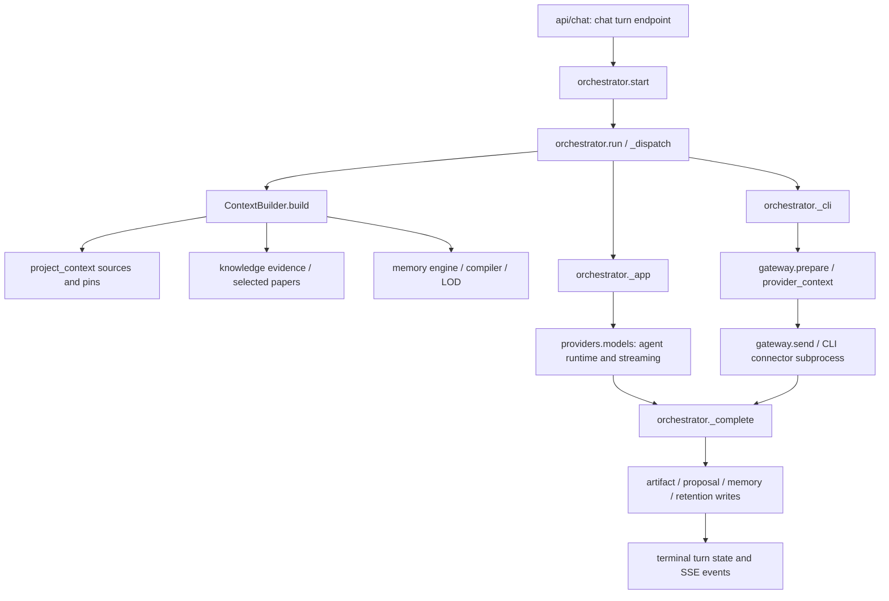

# Actual context and provider call graph

This describes the implemented path; it does not claim the entire requested target architecture is complete.

`ContextBuilder.build(session, question, effective)` owns the existing deterministic module-context implementation. `context.compile` and `build_unified_context_packet` are aliases to that callable. It collects trust-labeled sources, budgets/deduplicates context and emits a manifest; default raw recency dumps from unrelated conversations were removed. Explicit folder sharing remains available.

The app path uses `_history` for the current session and `providers.models.agent_runtime` for the configured engine/model. The CLI path uses `gateway.prepare`, the provider context packet/compiler and `gateway.send`; adapter events feed the orchestrator. Terminal completion follows all postprocessing writes. Failed gateway partial text cannot become completed.

Actual CPU mission/protocol execution remains in `execution/` and native research engines; visual graph catalog nodes without executable adapters block rather than fabricate outputs. Knowledge owns corpus/provenance, memory owns conversational/working state, but legacy cross-domain adapters remain.

Remaining consolidation: absorb specialized `intelligence/context_gateway.py` and `knowledge/research_context.py` policies into a shared implementation without losing role/topic/privacy semantics; migrate overlapping memory evidence/research lookup with compatibility shims; unify smart router and policy implementations; qualify every research engine path. A facade alone is not evidence that these are done.
