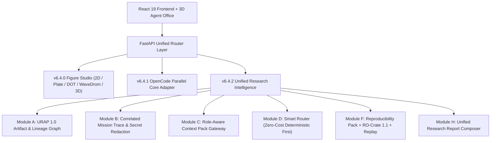

# PhD Research Lab v6.4.2 — Unified Research Intelligence Architecture

## 1. Architectural Overview
PhD Research Lab v6.4.2 unifies multi-engine research execution (`deterministic`, `feynman`, `openscience`, `opencode`, `app`), publication-grade scientific visualization (`v6.4.0 Figure Studio`), and cryptographic provenance (`URAP 1.0` + `RO-Crate 1.1`) under a single local-first Research Control Plane.

## 2. Core Modules
### Module A — Unified Research Artifact Protocol (`backend/intelligence/urap.py`)
- Content-addressed SHA-256 deduplication per `(topic_id, task_id, artifact_type, sha256)`.
- Strict cross-topic lineage isolation.
- Deterministic disk integrity check (`verify_integrity`) that marks tampered artifacts and all downstream descendants as `stale`.

### Module B — Agent Observability & Correlated Spans (`backend/intelligence/observability.py`)
- Correlates `trace_id`, `span_id`, `parent_span_id`, `mission_id`, `task_id`, and `runtime_id`.
- Automatic secret redaction (`sk-*`, bearer tokens, API keys) and SHA-256 fingerprint deduplication.

### Module C — Context Intelligence Gateway (`backend/intelligence/context_gateway.py`)
- Role-specific profiles (`literature_reviewer`, `experiment_engineer`, `verification_auditor`, `synthesis_author`).
- Strips prompt-injection patterns (`[REDACTED_PROMPT_INJECTION_ATTEMPT]`) from untrusted corpus text and enforces immutable task permissions.

### Module D — Smart Engine & Skill Router (`backend/intelligence/smart_router.py`)
- Deterministic capabilities (`paper.discover`, `figure.*`, `experiment.*`) always route to `deterministic` with `0` LLM calls.
- Never silently falls back to metered API billing when subscription/local quotas are exhausted (`status: "quota_limited"`, `metered_api_fallback: "disabled"`).

### Module E — Figure Studio & Scientific Integrity (`backend/figures/`)
- Supports 2D plots (`line`, `bar`, `scatter`, `ablation`), multi-panel comparison plates, Graphviz DOT diagrams, WaveDrom digital timing waveforms, and 3D scientific surfaces with camera state provenance.
- Append-only SQLite triggers on `figure_versions` guarantee immutable version history (`v1`, `v2`, ...).

### Module F & H — Reproducibility Pack (`RO-Crate 1.1`) & Report Composer
- Exports secret-scrubbed `.zip` bundles with `ro-crate-metadata.json`, `checksums.sha256`, `environment/requirements.lock`, `protocol/run_all.py`, and URAP lineage.
- Supports fresh-environment deterministic replay (`replay_reproducibility_pack`) and composes Markdown/LaTeX reports with explicit `[UNVERIFIED / HYPOTHESIS]` and `[PREPRINT]` flags.
