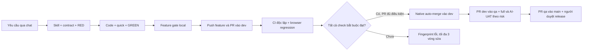

# Quy trình CI/CD dành cho chủ repo

Trạng thái triển khai phải đọc cùng `docs/qa/UAT_ACCEPTANCE_REPORT.md` và `agent/STATE.md`. Cấu hình đã viết, test local đã pass và CI GitHub đã pass là ba loại bằng chứng khác nhau. Chưa đạt đủ gate thì không merge hay phát hành.

## Khi bạn yêu cầu một tính năng qua chat

Agent đọc rule, giữ nguyên công việc đang dở, cập nhật dev và tạo `feature/<tên>`. Trước khi code, agent tìm skill phù hợp trên GitHub, kiểm tra nội dung và lưu phiên bản cố định cùng license trong `skills/`. Agent lập Feature Quality Contract, viết test hành vi, giữ bằng chứng RED, sửa code và giữ GREEN.

Trong lúc phát triển, agent chạy `python scripts/verify.py --profile quick`. Lệnh tự chọn phạm vi test theo thay đổi và dependency. Nếu không xác định chắc chắn, phạm vi được mở rộng. Frontend dùng toàn bộ suite frontend để tránh bỏ sót import động. Trước push dùng `feature`; GitHub chạy lại độc lập bằng `pr`. Bạn không cần nhắc lại danh sách lệnh sau mỗi tính năng.

## Mỗi nhánh dùng để làm gì

| Nhánh | Mục đích | Điều kiện merge |
|---|---|---|
| feature/* | Công việc đang phát triển | Local feature gate trước push; PR vào dev |
| dev | Tích hợp tính năng | `Development gate` xanh trên đúng commit; native squash auto-merge chỉ cho PR tin cậy |
| qa | Kiểm định bản ứng viên | PR từ dev; `QA gate`, full regression, live evidence và UAT bắt buộc đạt |
| main | Bản ổn định | PR từ qa; `Release gate`, reviewer và phê duyệt production của con người |

Không tự merge qa/main, không force-push, không dùng quyền admin để bỏ gate. GitHub auto-merge đã được bật, nhưng từng PR vẫn phải đủ điều kiện. Workflow auto-merge mới chỉ có hiệu lực sau khi định nghĩa của nó được đưa qua quy trình hợp lệ tới default branch; chưa được báo là đã hoạt động end-to-end chỉ vì có file YAML.

## Browser và AI-UAT

Playwright là regression chính: chạy browser thật, kiểm tra UI/backend, lưu trace/screenshot và lỗi console/network. Suite smoke và tự kiểm tra harness không cần LLM nên chạy được trên GitHub-hosted runner.

`uat` dùng adapter Browser Use riêng cho khám phá có chọn lọc. Mỗi lượt có app data, database, browser profile và cổng localhost riêng. Không gắn Chrome cá nhân hoặc dùng cookie cá nhân. Default dùng LM Studio `spark-x2.5-4b`, không tự chuyển sang Browser Use Cloud hay API trả phí. Adapter hiện hướng tới DOM; ảnh chụp và nhận xét của AI không tự chứng minh giao diện đạt chuẩn.

LOW không bắt buộc gọi LLM; MEDIUM chọn luồng bị ảnh hưởng. HIGH/CRITICAL cần bằng chứng khám phá và recovery theo contract; thiếu hạ tầng thì BLOCKED. Critical acceptance và release cần review độc lập/phê duyệt thực tế. Phát hiện AI chưa tái hiện được giữ là UNCONFIRMED. Khi tái hiện được, agent thêm regression hành vi rồi mới sửa và chạy lại.

## Cách đọc kết quả

Chỉ cần xem đầu ra ngắn `VERIFY: PASS/FAIL/BLOCKED`, profile/component, số case và đường dẫn `report.json`. Log đầy đủ nằm dưới `output/playwright/`. Nhiều test cùng lỗi connection được nhóm theo fingerprint, vẫn giữ đủ ID và stack trace gốc trên đĩa. Agent chỉ đọc phần lỗi cần thiết.

`quick`, `targeted`, `feature` là kết quả trong phạm vi phát triển; không thay thế `pr/full/release`. Coverage bắt buộc vẫn là 100% trên toàn bộ nguồn production đã khai báo, cả line/branch backend và bốn chỉ số frontend. Skip, thiếu provider, thiếu scientific review hoặc thiếu UAT bắt buộc không được đổi thành PASS. Kết quả từng bộ test và tỷ lệ coverage không chứng minh hết bug UI/UX; phải kiểm tra cả requirement, journey, recovery và bằng chứng thật.

## Khi nào cần bạn tham gia

Agent tự làm code, test, sửa trong giới hạn, commit, push feature, mở PR và theo dõi CI. Sau ba vòng sửa tự động thất bại cho cùng công việc/nhóm lỗi, agent dừng vòng sửa đó, giữ báo cáo và tiếp tục các phần độc lập nếu có. Tài nguyên/provider thiếu được báo rõ.

Bạn duyệt release vào main và các review độc lập được contract yêu cầu. Main hiện yêu cầu một reviewer khác author PR theo quy tắc GitHub; agent không tự approve thay bạn. Không phát hành nếu chỉ có bộ test hẹp xanh.

## Cài lại môi trường

Python CI dùng `requirements-ci.lock` với `--require-hashes`; Node dùng `npm ci` từ `frontend/package-lock.json`. Chromium được cài bằng Playwright cùng các thư viện hệ điều hành trên runner Linux. Browser Use là dependency phát triển tùy chọn trong `requirements-uat.lock`, dùng Python 3.12 riêng. Hosted runner không tự có LM Studio, subscription CLI, GPU hay image Docker từ máy của bạn. Live research phải có hạ tầng được cấp quyền và evidence tương ứng.

Mọi agent bắt đầu từ `AGENTS.md`, rồi `agent/AGENT.md`, `agent/STATE.md` và `agent/DEVELOPMENT_WORKFLOW.md`. Không được xóa file trong `skills/` hoặc `agent/`, kể cả khi dọn repo.
