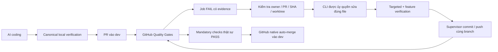

> Active owner policy (2026-10-25): develop/commit only on dev; full local pr/all software regression before dev push; dev -> qa -> main promotions. Coverage is informational. Real provider/research/AI-UAT is mandatory at QA/main. Older feature-to-dev instructions/examples below are historical and must not be executed. Current operator guide: [agent/DEV_QA_MAIN.md](../../agent/DEV_QA_MAIN.md), repair policy: [agent/CI_REPAIR_SUPERVISOR.md](../../agent/CI_REPAIR_SUPERVISOR.md). Never automatically merge main.

# Vận hành local CI Repair Supervisor

Supervisor là hạ tầng phát triển, tách khỏi Research Agent Harness. Nó polling GitHub bằng credential hiện có của Git Credential Manager, không cần webhook public hoặc cloud deployment. Nó không tự chạy khi import module hoặc khi nhận một PR bất kỳ.

## Luồng và quyền



`scripts/verify.py` là test entrypoint duy nhất. Profile `feature` là kiểm tra phát triển trước push; nó không thay thế `pr/full` và không chứng nhận100% coverage hoặc inference/scientific. Ba lần gọi CLI tối đa được ghi trước khi chạy, nên restart không làm mất budget. Bộ đếm AI-UAT cũ đã hết3 không được reset.

Trust policy do operator tạo cục bộ, nêu repository, PR, branch, HEAD được đối chiếu qua API, worktree độc quyền, executable CLI và SHA256, Python đã cài ngoài source PR, exact test IDs và exact source paths được sửa. Không cho agent sửa tests, workflows, assertions, permissions hay tài liệu chỉ dẫn để hợp thức hóa lỗi. Không mở quyền cho external PR/fork.

Đăng ký mẫu bên dưới chỉ dùng cho một PR được chủ repo cấp phép; thay placeholder bằng đường dẫn thực. Không chứa API key/token. `agent/templates/ci-repair-owner.example.json` là mẫu, không phải authorization đang hoạt động.

```powershell
python scripts/ci_repair_supervisor.py register --pr 123 --policy C:/private/ci-repair-owner.json --authorize-cli
python scripts/ci_repair_supervisor.py once --pr 123
python scripts/ci_repair_supervisor.py watch --pr 123 --apply
```

Mặc định không có `--apply` là chỉ quan sát. `--apply` cho phép CLI theo đúng registration sửa, sau đó supervisor kiểm thử/commit/push; không cho phép admin bypass hoặc sửa nhánh được bảo vệ. Khi một job backend đã FAIL và artifact xác nhận assertion được giao, có thể sửa trước khi toàn bộ matrix kết thúc. Trạng thái run tại lúc quan sát được ghi rõ; run đang chạy/cancelled không được báo là completed PASS.

```powershell
python scripts/ci_repair_supervisor.py status --pr 123
python scripts/ci_repair_supervisor.py stop --pr 123
python scripts/ci_repair_supervisor.py resume --pr 123
python scripts/ci_repair_supervisor.py watch --pr 123 --apply
```

`stop` được kiểm tra giữa các bước/poll; operation hiện tại có thể đang kết thúc. Ctrl+C trong invocation được xử lý để dừng process tree do supervisor tạo. `resume` không reset attempts. File lock hệ điều hành tránh hai supervisor cùng điều khiển một PR; registration cũng chặn dùng cùng worktree cho hai PR. Không tự lấy ownership của worktree đang dirty.

Nếu tool tạo file ngoài phạm vi, supervisor dừng. Operator phải kiểm tra và bảo toàn file đó, không mở rộng scope im lặng. Lệnh khôi phục đặc biệt sau khi review patch đã tồn tại là `adopt-owned-patch --pr N --authorize-cli`; chỉ áp dụng sau CLI đã kết thúc thành công, HEAD không đổi, và chỉ còn exact allowed paths. Nó không gọi lại model/reset budget. Đây là can thiệp của supervising operator, không phải human review độc lập hoặc bằng chứng vòng đầu chạy hoàn toàn không can thiệp.

## Credentials, adapters và giới hạn

- Git Credential Manager cần quyền đọc Actions/checks, đọc protection và ghi PR/contents cho repository. Credential ở controller; không ghi token ra file hoặc truyền token GitHub vào môi trường CLI.
- Codex chạy native `.exe`, `exec --sandbox workspace-write --json`, reasoning `high`, provider OpenAI; xác nhận login ChatGPT subscription trước invocation. Không dùng cờ bypass/shell shim hoặc API-credit fallback. Đường dẫn Python chính xác có trong prompt để tránh Windows Store alias.
- Claude dùng `--print --permission-mode acceptEdits`; Antigravity dùng `--print --sandbox --mode accept-edits`. Chúng chỉ chạy khi executable/subscription đã được operator xác nhận. Hiện chưa có bằng chứng real coding repair cho hai adapter này; không suy luận từ unit tests/help.
- Môi trường truyền các biến Windows chuẩn cần cho CLI/sandbox, loại các API/GitHub secret env. Workspace sandbox của coding agent không phải bằng chứng cho Docker containment của provider trong ứng dụng.
- Auto-merge chỉ được yêu cầu khi repo đã cho phép, PR không draft, cùng owner/repo/dev, current SHA/check app đúng, mọi mandatory job thực thi thành công và native protection vẫn có hiệu lực. Nếu quarantine còn tắt repo auto-merge, supervisor báo BLOCKED; nó không tự sửa repo settings.

## Bằng chứng diễn tập thực tế

PR10: https://github.com/Duy-Huan/PhD-Research-Lab/pull/10 . Initial deliberate fixture3FAIL; current experiment head/run và kết quả sau sửa phải lấy từ `.git/ci-repair/pr-10/state.json`, không suy đoán từ commit cũ.

Codex đã được gọi thật, thread `01a170e7-cb1c-7280-b971-d616b2c24a06`, tái hiện3 lỗi và sửa đúng offset `+1`. Lần đầu guard chặn cache `%SystemDrive%` do thiếu biến môi trường Windows; cache được bảo toàn, env được sửa và patch được adopt có ghi nhận supervising-agent intervention. Budget vẫn1. Targeted canonical tests sau sửa3PASS. Commit/push, CI mới, toàn bộ required checks xanh và native merge SHA phải được ghi sau khi thực sự xảy ra.

Usage quan sát cho turn đó:359315 input tokens, trong đó306304 cached,1488 output. Đây là số CLI báo, không phải chi phí tiền hoặc chứng minh tỷ lệ tiết kiệm. Supervisor gửi diagnostics gọn, nhưng agent tự đọc repo/instructions và tìm interpreter đã làm turn đầu tốn tài nguyên. Không gọi lại model chỉ để lặp verification; docs STATE/PLAN mới được rút gọn và giữ bản cũ trong `agent/history/`.

Coverage/SDK/live/AI-UAT blockers vẫn thật; không sửa gate để diễn tập được merge. Nếu chưa có tất cả checks PASS, acceptance end-to-end hoàn chỉnh vẫn BLOCKED và không có final merge SHA.

Npm CLI c? th? ??ng k? native Node executable c?ng `entry_script` JS/MJS ngo?i PR worktree v? `entry_script_sha256`; c? executable l?n script ??u pin hash. Kh?ng g?i `.cmd/.bat/.ps1` v?i diagnostics. C?u h?nh n?y l? kh? n?ng adapter, kh?ng ph?i ch?ng nh?n ?? ch?y Claude/Antigravity th?t.
