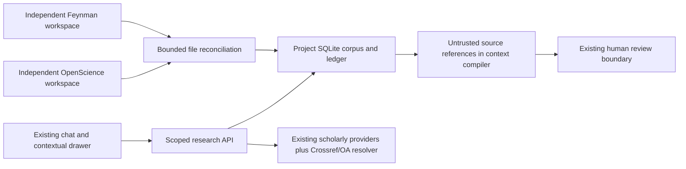

# v5.1–v5.3 audit (2026-10-21)

Baseline: branch `feature/v3.2-research-os`, HEAD `f6e8c73dde24c5e04ab44d90aae1aa7254cc1c24`, application 5.1.0.
The five upgrade documents are target specifications/catalogs, not evidence of installed integrations.

## Existing contracts and gaps

| Concern | Actual code | Gap / minimal addition |
|---|---|---|
| Project storage | `backend/core/config.py`: project_meta.json, project_scope ContextVar; JSON per project | Preserve paths, chats and memory; separate SQLite corpus/ledger under workspace/research/ |
| Chat | `frontend/assets/chat.js`, `backend/agent/sessions.py`, context compiler with trust manifests | Bind optional topic to conversation, enforce scoped evidence resolution |
| UI | Vanilla JS `PL`, existing panels/modal/router, jsdom tests | Reuse drawer, one action registry and selected-source chips |
| Skills/plugins | `backend/agent/skills.py`, `backend/plugins/__init__.py`: GitHub snapshots, no arbitrary hooks executed | Keep skill importer; optional tool descriptors must report missing dependencies |
| Papers | websearch.py: OpenAlex/S2/arXiv/IEEE/Scholar; library.py; bounded download.py; pypdf/PyMuPDF pages | Topic inbox, normalized aliases, version/chunk index, approval, budgets/jobs; Crossref and Unpaywall |
| Memory | `backend/memory/`, approval lifecycle; graph/retrieval local | Corpus does not auto-write trusted memory or bibliography |
| Runs | `backend/agent/runs.py`, guarded experiment execution, ClearML | Scientific ingestion is deterministic I/O, separate from costly AI runs; lifespan polling for due work |
| Engines | sibling `backend/research_engines/{feynman,openscience}.py`, typed task contract | Native workspaces are separate from task dispatch; independent file reconciliation |

## Compatibility matrix

| Capability | OpenScience | Feynman | Current PhD Lab | Strategy |
|---|---|---|---|---|
| Native launch | Verified CLI 2.0.152: `web [project]` | Verified CLI 0.5.51: interactive, `--cwd`, `--session-dir` | Task dispatch only | argv arrays, canonical cwd; browser launch for OpenScience, explicit terminal command for Feynman |
| Session metadata | Official SDK for admitted sessions verified in previous audit | Export of selected session documented in installed help | Own runs known | Do not enumerate private native databases; report external sessions unknown |
| Events/replay | Admitted runtime sessions supported, bounded replay | External event subscription unverified | Existing admitted-job cursors | Keep existing runtime integration; external file observation has partial fidelity |
| Artifact enumeration | Native runtime artifacts for admitted tasks | Files materialized in workspace | Own run outputs | Deterministic file inventory, hashes and versions |
| Observe external sessions | Complete capture unverified | Complete capture unverified | Missing | No fabricated session/action history |
| Recover offline | Persisted artifacts observable | Persisted artifacts observable | Missing | Transactional checkpoint, rescan, tombstones; omissions reported |

Actual commands: PowerShell `.ps1` shims blocked by execution policy; `.cmd` works. Feynman version/help exit 0. OpenScience default version/help fail with EEXIST at user config directory. Isolated temporary OPENSCIENCE_DATA_DIR/CONFIG_DIR/TEST_HOME yields version 2.0.152 and help exit 0. User engine configuration was not repaired or overwritten. Native launch acceptance remains conditional on that setup.

## Storage and migration decision

No existing ORM/database covers topics or scholarly versions. Add one stdlib SQLite store per existing project at `workspace/research/research.sqlite3`, schema-versioned, foreign keys and transactions. Stable UUIDs for project identity (in new DB), topics, workspaces and papers. Legacy project_meta.json and conversation files remain authoritative for their existing features; no destructive migration. Legacy library import is explicit and idempotent, with no inferred L4 status. New canonical native directories: `<project>/topics/<uuid>/<engine>_prj`; link existing folders only after overlap and symlink checks. External folders are read-only to sync; no engine database mutation.

## Risks / acceptance boundaries

Document parsing can be partial; no invented pages. L4 is user attestation. Source credentials/rate limits can vary. Optional Docling/Optuna/Zotero integrations must degrade honestly; no automatic heavyweight dependency installs. File inventory must not traverse links or infer metrics. A truncated/unstable scan must not tombstone unseen files. Never launch a native engine during tests or send model prompts to validate deterministic operations. Existing OpenScience runtime adapter is not an external-session observer. Live provider/engine acceptance and optional catalogue integrations are tracked separately from offline regression evidence.
